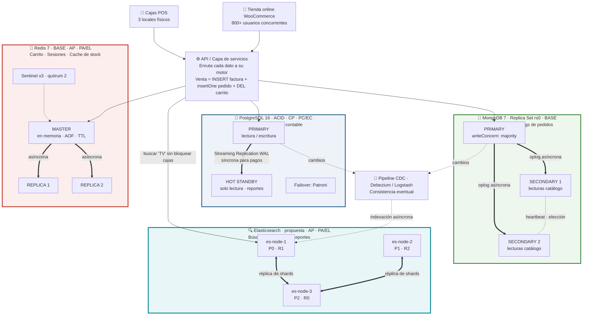

# Distribuidora Valle Express - Rescate Políglota

> **Taller No. 3 – Parcial 1 · Modelado Avanzado de Base de Datos**
> Universidad de las Fuerzas Armadas ESPE · Ciencias de la Computación · Sexto nivel

| Rol | Integrante |
|---|---|
| Arquitecto CAP / Ingeniero de Caos | Denilson Celi |
| DBA SQL | Farid Hinojoza |
| DBA NoSQL | Jose María Sandoval |

---

## 📌 El problema

**Distribuidora Valle Express** (Sangolquí) vende electrodomésticos y abarrotes en 3 locales físicos y una tienda online en WordPress/WooCommerce. Toda su operación vivía en **una única instancia MySQL 5.7**, dentro de una sola tabla `ventas_todo` de 47 columnas y con un campo JSON gigante (`detalle_productos`).

**Viernes Negro 2025:**

| Hora | Qué pasó |
|---|---|
| 10:00 | 800 usuarios simultáneos. `SELECT * FROM ventas_todo WHERE detalle_productos LIKE '%TV%'` bloqueó la tabla durante 45 s |
| 10:05 | Las cajas de los 3 locales no podían facturar (bloqueo de tabla de MyISAM). Fila de 30 clientes |
| 11:30 | El servidor se cayó porque el disco se llenó de logs binarios. **No había réplica** |
| 14:00 | Pérdida: **$18,000** + 120 clientes molestos + 3 horas de inventario sin registrar |

> *"¿Por qué si tenemos una base de datos potente, todo se cae cuando más vendemos?"* — Gerente

**Respuesta corta:** no era un problema de potencia. Se usó **un solo motor para datos con necesidades opuestas**. Según el teorema **CAP** (Gilbert & Lynch, 2002) y **PACELC** (Abadi, 2012), ningún motor puede optimizar a la vez consistencia, disponibilidad y latencia.

---

## 🏗️ Arquitectura propuesta

Cada tipo de dato va al motor cuyo compromiso CAP/PACELC le corresponde (**persistencia políglota**), y cada motor tiene su propia estrategia de réplica.



> **Nota:** el diagrama muestra el despliegue objetivo de producción. En el laboratorio (`docker-compose.yml`) cada motor corre como un solo contenedor, y MongoDB arranca como replica set `rs0` de 1 nodo.

---

## 📋 Tabla de diseño

| Dato | Motor | Justificación teórica (ACID/BASE + CAP + PACELC) | Metodología de réplica |
|---|---|---|---|
| Facturas, Pagos, Stock contable | **PostgreSQL** | **ACID**: la venta (factura + pago + stock) es una sola transacción, así que no se puede perder ni duplicar un pago. **MVCC** con bloqueo por fila, no por tabla como MyISAM. **CAP: CP** · **PACELC: PC/EC** | Streaming Replication (WAL): 1 standby síncrono + réplica de lectura. Failover con Patroni. Retención de WAL controlada |
| Catálogo (atributos variables), Clientes, Logs de pedidos | **MongoDB** | **BASE**: documentos sin esquema rígido (persistencia polimórfica). Catálogo: **AP / PA-EL** (lee de secundarios). Pedidos y clientes: **CP / PC-EC** con `w: majority` | Replica Set de 3 nodos (1 Primary + 2 Secondary) por oplog. `writeConcern: majority`, `readPreference: secondaryPreferred` |
| Carrito, Sesiones, Cache de stock | **Redis** | **BASE**: key-value en memoria con latencia < 1 ms. Si se pierde un carrito no se pierde dinero. **CAP: AP** · **PACELC: PA/EL**. Datos con TTL | Master + 2 réplicas asíncronas. Redis Sentinel ×3 (quórum 2). Persistencia AOF |
| Búsquedas de texto, Reportes históricos | **Elasticsearch** *(propuesta)* | **BASE**: índice invertido, así que buscar "TV" no bloquea las cajas. **CAP: AP** · **PACELC: PA/EL** (casi tiempo real) | Clúster de 3 nodos con `number_of_replicas: 1`. Se alimenta por CDC desde PostgreSQL y MongoDB |

### Persistencia políglota vs. polimórfica

- **Políglota** (dónde vive el dato): varios motores, cada uno elegido según la naturaleza del dato.
- **Polimórfica** (cómo se modela el dato): una misma colección guarda documentos con estructuras distintas. Por ejemplo, un TV tiene `pulgadas` y `resolucion`, y el arroz tiene `peso_kg` y `marca`.

---

## 🚀 Cómo levantar el laboratorio

**Requisitos:** Docker Desktop abierto y en estado *Engine running*.

```bash
git clone <URL-de-este-repo>
cd <carpeta-del-repo>
docker compose up -d
docker ps
```

| Servicio | URL / Puerto | Credenciales |
|---|---|---|
| PostgreSQL | `localhost:5432` | `admin` / `Admin123` · BD `distribuidora_acid` |
| pgAdmin | http://localhost:5050 | `profe@distribuidora.ec` / `Admin123` |
| MongoDB | `localhost:27017` | sin autenticación · replica set `rs0` |
| Mongo Express | http://localhost:8081 | — |
| Redis | `localhost:6379` | password `Admin123` |
| Redis Commander | http://localhost:8082 | — |

> ⚠️ Si `rs.status()` devuelve *no replset config has been received*, inicializa el replica set a mano (solo una vez):
> ```bash
> docker exec -it distribuidora_mongo mongosh --eval "rs.initiate({_id:'rs0',members:[{_id:0,host:'distribuidora_mongo:27017'}]})"
> ```

---

## 🧪 Caso de uso distribuido: una venta

Una sola venta toca los tres motores, cada uno con su propia garantía:

**1. PostgreSQL: factura (ACID)**
```sql
CREATE TABLE facturas (
  id SERIAL PRIMARY KEY,
  numero INT UNIQUE NOT NULL,
  cliente_cedula VARCHAR(13) NOT NULL,
  local VARCHAR(30) NOT NULL,
  total NUMERIC(10,2) NOT NULL,
  metodo_pago VARCHAR(20) NOT NULL,
  fecha TIMESTAMP DEFAULT NOW()
);

BEGIN;
INSERT INTO facturas (numero, cliente_cedula, local, total, metodo_pago)
VALUES (1001, '1723456789', 'Online', 658.54, 'Tarjeta');
COMMIT;

SELECT * FROM facturas;
```

**2. MongoDB: catálogo polimórfico y detalle del pedido**
```js
use distribuidora

db.productos.insertMany([
  { _id: "TV-SAM-55", nombre: "Televisor Samsung 55", categoria: "electrodomesticos",
    precio: 649.99, atributos: { pulgadas: 55, resolucion: "4K", smart: true } },
  { _id: "ARZ-001", nombre: "Arroz Gustadina 2kg", categoria: "abarrotes",
    precio: 2.85, atributos: { peso_kg: 2, marca: "Gustadina", perecible: false } }
])

db.pedidos.insertOne({
  factura_id: 1001, cliente_cedula: "1723456789", local: "Online", fecha: new Date(),
  items: [ { sku: "TV-SAM-55", cant: 1, precio: 649.99 },
           { sku: "ARZ-001", cant: 3, precio: 2.85 } ],
  total: 658.54
}, { writeConcern: { w: "majority" } })

rs.status()
```

**3. Redis: carrito, sesión y vaciado del carrito**
```
HSET carrito:1723456789 TV-SAM-55 1 ARZ-001 3
SET sesion:abc123 "1723456789" EX 1800
GET sesion:abc123
SET stock:TV-SAM-55 14
GET stock:TV-SAM-55
DEL carrito:1723456789
HGETALL carrito:1723456789
```

---

## 📸 Evidencias

| `rs.status()` en MongoDB | `SELECT` en PostgreSQL | `GET` en Redis |
|---|---|---|
|  |  |  |

---

## 💥 Prueba de supervivencia (Plan de Caos)

| Escenario | Qué se cayó | Qué siguió funcionando | Qué se perdió | Justificación CAP |
|---|---|---|---|---|
| `docker stop distribuidora_postgres` | Facturación y pagos | Catálogo en MongoDB, carritos y sesiones en Redis | No se emiten facturas nuevas; las existentes persisten en el volumen | PostgreSQL es **CP**: prefiere no responder antes que ser inconsistente. En producción asume el hot standby |
| `docker stop distribuidora_mongo` | Catálogo y detalle de pedidos | PostgreSQL sigue facturando; Redis sigue activo | No se consulta el catálogo; los pedidos se encolan | En el lab el rs tiene 1 nodo. Con 3 nodos se elige un nuevo Primary en segundos |
| `docker stop distribuidora_redis` | Carritos, sesiones y cache | PostgreSQL y MongoDB operan; el stock se lee de PostgreSQL | Carritos y sesiones activas (los usuarios vuelven a iniciar sesión) | Redis es **AP / PA-EL**: la pérdida es aceptable porque no involucra dinero. En producción, Sentinel promueve una réplica |

---

## 🎥 Video de defensa

▶️ [Ver video en Loom](LINK-DEL-VIDEO)

---

## ✅ Conclusiones

1. El colapso no se debió a falta de potencia, sino a usar un solo motor y una sola tabla para datos con necesidades opuestas. CAP y PACELC demuestran que no existe un motor que optimice todo a la vez.
2. Separar transacciones (PostgreSQL), catálogo y pedidos (MongoDB), sesiones (Redis) y búsquedas (Elasticsearch) **aísla los fallos**: la caída de un motor degrada una función, pero no detiene la facturación.
3. La **réplica es obligatoria** y específica para cada motor. Elimina el punto único de falla que dejó a la empresa sin servicio.

---

## 📚 Referencias

- Abadi, D. (2012). Consistency tradeoffs in modern distributed database system design: CAP is only part of the story. *Computer, 45*(2), 37-42. https://doi.org/10.1109/MC.2012.33
- Gilbert, S., & Lynch, N. (2002). Brewer's conjecture and the feasibility of consistent, available, partition-tolerant web services. *ACM SIGACT News, 33*(2), 51-59.
- Pritchett, D. (2008). BASE: An ACID alternative. *ACM Queue, 6*(3), 48-55. https://doi.org/10.1145/1394127.1394128
- Sadalage, P. J., & Fowler, M. (2012). *NoSQL distilled: A brief guide to the emerging world of polyglot persistence*. Addison-Wesley.
- MongoDB, Inc. (s.f.). *Replication*. https://www.mongodb.com/docs/manual/replication/
- Redis Ltd. (s.f.). *High availability with Redis Sentinel*. https://redis.io/docs/latest/operate/oss_and_stack/management/sentinel/
